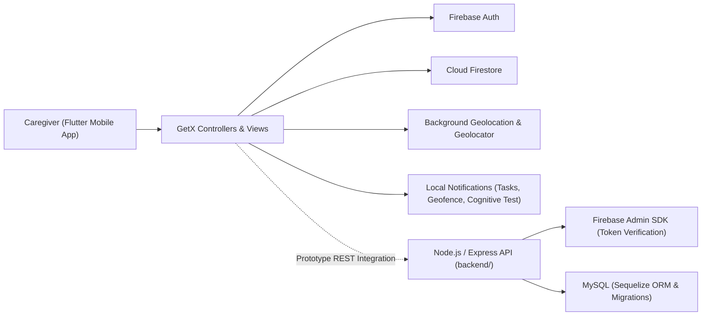

<div align="center">
  

  <h1>Memory Care</h1>

  <p>
    <strong>Assistive mobile application for caregivers of elderly individuals with memory impairments.</strong>
  </p>

  <p>
    <strong>English</strong> | <a href="README.pt-BR.md">Português (Brasil)</a>
  </p>

  <p>
    <a href="https://youtu.be/hovdYkmaexM">
      
    </a>
    
    
    
  </p>
</div>

---

## Table of Contents

- [Overview](#overview)
- [Demo](#demo)
- [Key Features](#key-features)
- [Architecture & Tech Stack](#architecture--tech-stack)
- [Project Structure](#project-structure)
- [Data Model](#data-model)
- [Getting Started](#getting-started)
- [Current Scope & Roadmap](#current-scope--roadmap)
- [Author & Context](#author--context)
- [License](#license)

---

## Overview

**Memory Care** is a mobile application built to assist primary and secondary caregivers in supporting elderly dependents living with memory loss (such as Alzheimer's disease and age-related cognitive decline). Originally developed as a 2024 capstone project (**TCC — SENAI CIMATEC**), the app centralizes routine organization, safe-zone geofencing alerts, caregiver coordination, and periodic cognitive screening in a single mobile workflow.

The application interface (`pt_BR`), localization, and cognitive test protocols are written in Brazilian Portuguese and support automatic light and dark themes based on system brightness.

---

## Demo

Watch the application demonstration on YouTube:

- **Video Demo:** [https://youtu.be/hovdYkmaexM](https://youtu.be/hovdYkmaexM)

---

## Key Features

### 1. Caregiver & Dependent Onboarding and Profiles
- **Guided Sign-Up Flow:** Caregivers register with email and password (`FirebaseAuth`), complete their caregiver profile (`SignUpPageComplimentary`), and link the dependent's profile (`RegistroDependente`).
- **Smart Startup Routing:** On app launch, `AuthenticationRepository` checks authentication state, caregiver registration, and whether the current week's cognitive test has been completed, automatically directing the user to `WelcomePage`, `PaginaTransicaoAnalise`, or `HomePage`.
- **Profile Management:**
  - **Primary Caregiver (`PerfilCuidador`):** Displays account details and supports session logout.
  - **Dependent (`PerfilDependente` / `EditarPerfilDependente`):** Displays and updates full name, age, phone number, emergency contact, residential address, and primary caregiver name in Cloud Firestore.
  - **Secondary Caregivers (`PerfilCuidadorSecundario`):** Full CRUD (create, real-time list stream, edit, delete) for auxiliary caregivers including name, age, relationship/role, email, and phone.

### 2. Daily Routine & Task Management (`Tarefas`)
- **Live Daily Dashboard:** Displays the current day of the week in Portuguese (`pt_BR`), a real-time clock, and a live Firestore stream of scheduled tasks.
- **Task CRUD (`AddTaskPage` / `EditorRemoveTaskPage`):** Create, edit, delete, mark tasks as completed (`pendente` / `concluida`), and flag recurring tasks (`tarefaSeRepete`).
- **Exact Local Alarm Notifications (`TarefasNotificationService`):** Uses `flutter_local_notifications` and `timezone` (`America/Sao_Paulo`) with `AndroidScheduleMode.exactAllowWhileIdle` to trigger reminders at each task's scheduled date and time.

### 3. Safe Zones & Background Geofencing (`Áreas Seguras`)
- **Interactive OpenStreetMap View (`Mapa`):** Renders OpenStreetMap tiles (`flutter_map` + `latlong2`), tracks current device location via `geolocator`, and draws registered safe zones as circular map overlays (`CircleLayer`).
- **Map-Based Zone Creation (`AddGeoFence`):** Long-press anywhere on the map to define a safe zone with a custom name and radius (in meters), persisted as a Firestore `GeoPoint` and radius.
- **Safe Zone Management (`AllGeoFences` / `TelaRemoverArea`):** View active zones and delete zones simultaneously from Cloud Firestore and the background geofence engine.
- **Background Geofence Monitoring (`GeofencingService` & `GeofenceNotificationService`):** Powered by `flutter_background_geolocation` (`stopOnTerminate: false`, `startOnBoot: true`) to emit high-priority local notifications whenever the device enters (`ENTER`) or exits (`EXIT`) a registered safe zone.

### 4. Weekly Cognitive Screening / Predictive Analysis (`Análise Preditiva`)
- **7-Domain Assessment (`Dominio1` – `Dominio7`):** Guided cognitive evaluation inspired by the **Mini-Mental State Examination (MMSE / MEEM)** on a **0–30 point scale**:

| Domain | Screen | Focus Area | Max Points |
| :--- | :--- | :--- | :---: |
| Domain 1 | `Dominio1` | Temporal Orientation (year, month, day of week, day of month, season) | 5 |
| Domain 2 | `Dominio2` | Spatial Orientation (setting, city, state, venue name, floor) | 5 |
| Domain 3 | `Dominio3` | Word Registration (repeating *"casa, bola, árvore"*) | 3 |
| Domain 4 | `Dominio4` | Attention & Calculation (attention task / spelling *"MUNDO"* backwards) | 5 |
| Domain 5 | `Dominio5` | Delayed Memory Recall (recalling *"casa, bola, árvore"*) | 3 |
| Domain 6 | `Dominio6` | Language (visual naming of watch & pen, phrase repetition, 3-step command, reading *"FECHE OS OLHOS"*, sentence writing) | 8 |
| Domain 7 | `Dominio7` | Visuospatial Skill (copying intersecting pentagons figure) | 1 |
| **Total** | | | **30** |

- **Automatic Classification (`AnalisePreditivaController`):**
  - `24 – 30`: *Cognitivo normal* (Normal cognition)
  - `18 – 23`: *Comprometimento cognitivo leve* (Mild cognitive impairment)
  - `< 18`: *Comprometimento cognitivo moderado a grave* (Moderate to severe cognitive impairment)
- **Weekly History & Reminders (`HistoricoPage` & `AnalisePredNotificationService`):** Stores one record per week (`YYYY-Wxx`) in Firestore, displays historical scores and timestamps (`TesteInfoWidget`), and triggers reminder notifications when the current week's test is still pending.

---

## Architecture & Tech Stack

The Flutter app follows an MVC + Repository pattern managed with **GetX** and **RxDart**, persisting data directly to **Firebase Auth** and **Cloud Firestore**. The repository also includes a **Node.js + Express + Sequelize** backend prototype in `backend/` with Firebase Admin JWT verification and MySQL migrations.



### Frontend Stack (`frontend/`)
- **Framework & Language:** Flutter, Dart SDK `^3.5.3`
- **State Management & Routing:** `get: ^4.6.6`, `rxdart: ^0.28.0`
- **Backend-as-a-Service:** `firebase_core: ^3.6.0`, `firebase_auth: ^5.3.1`, `cloud_firestore: ^5.4.5`
- **Maps & Geofencing:** `flutter_map: ^7.0.2`, `latlong2: ^0.9.1`, `geolocator: ^13.0.2`, `flutter_background_geolocation: ^4.16.5`, `background_fetch: ^1.3.7`
- **Notifications & Localization:** `flutter_local_notifications: ^18.0.1`, `timezone: ^0.10.0`, `intl: ^0.19.0`
- **UI & Assets:** `google_fonts: ^6.2.1`, `line_awesome_flutter: ^3.0.1`, `flutter_otp_text_field: ^1.2.0`, `flutter_native_splash: ^2.4.2`, `flutter_launcher_icons: ^0.14.1`, `url_launcher: ^6.3.1`
- **Android Build Config:** `applicationId: com.memorycare.app`, `minSdk: 23`, `compileSdk / targetSdk: 34`, Java 8 with core library desugaring and `multiDexEnabled: true`

### Backend Stack (`backend/`)
- **Runtime & Server:** Node.js, `express: ^4.21.1`
- **Authentication:** `firebase-admin: ^12.7.0`, `jsonwebtoken: ^9.0.2`, `passport`, `bcrypt`
- **ORM & Databases:** `sequelize: ^6.37.5`, `sequelize-cli: ^6.6.2`, `mysql2: ^3.11.3`, `mysql: ^2.18.1`, `sqlite3: ^5.1.7`
- **Middleware & Utilities:** `body-parser`, `cors`, `helmet`, `dotenv`, `express-session`, `express-validator`, `multer`

---

## Project Structure

```text
memorycare/
├── README.md                              # Primary documentation (English)
├── README.pt-BR.md                        # Documentation in Brazilian Portuguese
├── backend/                               # Node.js / Express + Sequelize API prototype
│   ├── app.js                             # Express entry point, Firebase Admin auth & routes
│   ├── package.json
│   ├── config/                            # Sequelize & Firebase Admin configuration
│   ├── migrations/                        # Sequelize migrations (Cuidador, Dependente, Tarefas, DependenteCuidadors)
│   ├── models/                            # Sequelize models
│   └── routes/                            # Express routes (/register, /registrarDependente)
└── frontend/                              # Flutter mobile application
    ├── pubspec.yaml                       # Dependencies, assets, and splash config
    ├── firebase.json                      # FlutterFire configuration metadata
    ├── flutter_launcher_icons.yaml        # Adaptive launcher icon configuration
    ├── assets/                            # App logos, icons, and cognitive test images
    ├── android/                           # Android Gradle & Manifest (location, alarm, boot permissions)
    ├── ios/                               # iOS Runner configuration
    └── lib/
        ├── main.dart                      # App initialization, Firebase, notifications & geofencing
        ├── firebase_options.dart          # Generated Firebase platform options
        └── src/
            ├── app.dart                   # GetMaterialApp, themes, and named routes
            ├── constants/                 # Asset path constants
            ├── controllers/               # GetX controllers (auth, profiles, tasks, areas, cognitive test)
            ├── models/                    # Domain models (Cuidadores, Dependente, Tarefa, Area, AnalisePreditiva)
            ├── repository/                # Firebase Auth & Firestore data repositories
            ├── services/                  # Geofencing & local notification services
            ├── utils/themes/              # Light/dark Material theme definitions
            ├── views/                     # App screens grouped by feature module
            └── widgets/                   # Reusable forms, buttons, and cards
```

---

## Data Model

### Cloud Firestore (Active App Database)
```text
cuidadores/{uid}
└── dependente/{dependenteId}
    ├── tarefas/{tarefaId}
    ├── cuidadoresSecundarios/{cuidadorSecundarioId}
    ├── areas/{areaId}
    └── analise_preditiva/{YYYY-Wxx}
```

### Relational Schema (`backend/migrations/`)
- `Cuidador` (`firebaseUid` PK, `nome`, `idade`, `parentesco_funcao`, `email`, `telefone`)
- `Dependente` (`id` PK, `nome`, `idade`, `contato_emergencia`, `observacoes`, `residencia`, `cuidador_ID` FK)
- `Tarefas` (`id` PK, `id_dependente_FK` FK, `titulo`, `texto`, `horario`, `status`, `tarefa_se_repete`, `criado_em`)
- `DependenteCuidadors` (join table linking `dependenteId` and `cuidadorId`)

---

## Getting Started

### Prerequisites
- **Flutter SDK** compatible with Dart `^3.5.3`
- **Android Studio / Android SDK** (with Android API 23+ emulator or physical device; `compileSdk 34`)
- A **Firebase project** with **Email/Password Authentication** and **Cloud Firestore** enabled
- *(Optional, for backend prototype)* **Node.js (v18+)** and **MySQL**

### 1. Clone the Repository
```bash
git clone https://github.com/VitorManuel01/memorycare.git
cd memorycare
```

### 2. Configure and Run the Flutter App (`frontend/`)
1. Navigate to the Flutter project directory and install dependencies:
   ```bash
   cd frontend
   flutter pub get
   ```
2. Configure Firebase for your own environment using [FlutterFire CLI](https://firebase.flutter.dev/docs/cli/) (recommended) so `lib/firebase_options.dart` and `android/app/google-services.json` match your Firebase project:
   ```bash
   flutterfire configure
   ```
3. Grant the required Android runtime permissions when prompted on first launch (Notifications, Exact Alarms, Fine/Background Location) so task reminders and geofencing work properly.
4. Run the app:
   ```bash
   flutter run
   ```

> **Note on `flutter_background_geolocation`:** On Android, debug builds run in sandbox/debug mode out of the box (`debug: true` in `GeofencingService`). Release builds for Google Play require a TransistorSoft license key if targeting production Android distribution.

### 3. *(Optional)* Run the Backend Prototype (`backend/`)
> **Security Notice:** Replace any placeholder/sample database settings in `backend/config/config.json`, `backend/config/database.js`, and your Firebase Admin service account JSON with your own local or environment-specific credentials before deploying.

```bash
cd backend
npm install
npx sequelize-cli db:migrate
node app.js
```
The Express server listens on `http://localhost:3000`.

---

## Current Scope & Roadmap

To keep documentation transparent with the current codebase:
- **Primary Caregiver Editing:** `EditarPerfilCuidador` provides the edit form UI, while the save action currently navigates back to `HomePage` without persisting updates to Firestore yet.
- **Auth Extras:** Phone OTP verification methods are implemented in `AuthenticationRepository` / `OTPController`, whereas the Google Sign-In button (`LoginFooterWidget`) and Password Reset views (`TelaEsqueciSenhaEmail`, `TelaEsqueciSenhaPhone`) are currently UI scaffolding.
- **Backend Sync:** The active app stores and reads all records directly via Firebase Auth and Cloud Firestore; the Express/MySQL calls in `AuthService` and `SignUpController` are commented/prototyped for future hybrid backend expansion.
- **Wear OS Exploration:** `pubspec.yaml` includes commented dependencies (`wear`, `wearable_rotary`, `flutter_blue_plus`) planned for future smartwatch companion support.
- **Automated Tests:** `frontend/test/widget_test.dart` still contains the default Flutter counter template test and needs replacement with feature tests.

---

## Author & Context

- **Developer:** [Vitor Manuel](https://github.com/VitorManuel01)
- **Academic Context:** TCC 2024 — **SENAI CIMATEC** (`senai-tcc-group-memcare`)

---

## License

The `backend/` package declares the `ISC` license in [`backend/package.json`](backend/package.json). No root `LICENSE` file has been added to the repository yet.
