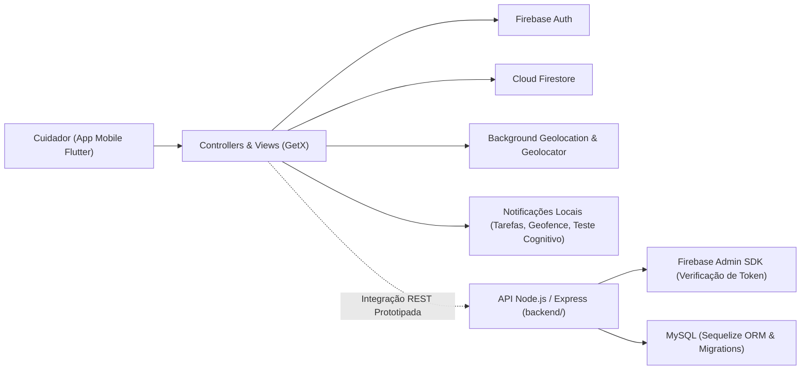

<div align="center">
  

  <h1>Memory Care</h1>

  <p>
    <strong>Aplicativo móvel assistivo para cuidadores de idosos com dificuldades de memória.</strong>
  </p>

  <p>
    <a href="README.md">English</a> | <strong>Português (Brasil)</strong>
  </p>

  <p>
    <a href="https://youtu.be/hovdYkmaexM">
      
    </a>
    
    
    
  </p>
</div>

---

## Índice

- [Visão Geral](#visão-geral)
- [Demonstração](#demonstração)
- [Principais Funcionalidades](#principais-funcionalidades)
- [Arquitetura e Tecnologias](#arquitetura-e-tecnologias)
- [Estrutura do Projeto](#estrutura-do-projeto)
- [Modelo de Dados](#modelo-de-dados)
- [Como Executar o Projeto](#como-executar-o-projeto)
- [Escopo Atual e Próximos Passos](#escopo-atual-e-próximos-passos)
- [Autor e Contexto](#autor-e-contexto)
- [Licença](#licença)

---

## Visão Geral

O **Memory Care** é um aplicativo móvel desenvolvido para auxiliar cuidadores principais e secundários no acompanhamento de idosos ou dependentes com dificuldades de memória (como doença de Alzheimer e declínio cognitivo). Concebido originalmente como projeto de conclusão de curso (**TCC 2024 — SENAI CIMATEC**), o aplicativo reúne em um único fluxo a organização da rotina diária, o monitoramento de áreas seguras por geofencing, a gestão de cuidadores e a aplicação semanal de triagem cognitiva.

A interface do aplicativo, a formatação de datas (`pt_BR`) e os questionários cognitivos estão totalmente em Português do Brasil, com suporte automático aos modos claro e escuro conforme o tema do sistema.

---

## Demonstração

Assista ao vídeo de demonstração do aplicativo no YouTube:

- **Vídeo Demo:** [https://youtu.be/hovdYkmaexM](https://youtu.be/hovdYkmaexM)

---

## Principais Funcionalidades

### 1. Cadastro, Autenticação e Gestão de Perfis
- **Fluxo de Cadastro Guiado:** O cuidador cria sua conta com e-mail e senha (`FirebaseAuth`), preenche os dados complementares do cuidador (`SignUpPageComplimentary`) e registra os dados do dependente (`RegistroDependente`).
- **Redirecionamento Inteligente na Inicialização:** Ao abrir o aplicativo, o `AuthenticationRepository` verifica o estado de autenticação, o vínculo com o perfil do cuidador e se o teste cognitivo da semana atual já foi realizado, direcionando automaticamente para `WelcomePage`, `PaginaTransicaoAnalise` ou `HomePage`.
- **Perfis Integrados:**
  - **Perfil do Cuidador Principal (`PerfilCuidador`):** Exibe os dados da conta e permite encerrar a sessão (`logout`).
  - **Perfil do Dependente (`PerfilDependente` / `EditarPerfilDependente`):** Visualização e edição completa no Cloud Firestore de nome completo, idade, telefone, contato de emergência, endereço residencial e cuidador principal.
  - **Cuidadores Secundários (`PerfilCuidadorSecundario`):** CRUD completo (cadastro, listagem em tempo real via stream, edição e exclusão) com nome, idade, parentesco/função, e-mail e telefone.

### 2. Rotina Diária e Gestão de Tarefas (`Tarefas`)
- **Painel em Tempo Real:** Exibe o dia da semana localizado (`pt_BR`), relógio atualizado em tempo real e lista de tarefas sincronizada via stream do Cloud Firestore.
- **CRUD de Tarefas (`AddTaskPage` / `EditorRemoveTaskPage`):** Criação, edição, marcação de conclusão (`pendente` / `concluida`), indicação de recorrência (`tarefaSeRepete`) e exclusão de tarefas.
- **Notificações Locais Agendadas (`TarefasNotificationService`):** Utiliza `flutter_local_notifications` e `timezone` (`America/Sao_Paulo`) com `AndroidScheduleMode.exactAllowWhileIdle` para disparar lembretes na data e horário programados.

### 3. Áreas Seguras e Geofencing em Segundo Plano (`Áreas Seguras`)
- **Mapa Interativo com OpenStreetMap (`Mapa`):** Utiliza `flutter_map` + `latlong2`, obtém a localização atual pelo `geolocator` e desenha as áreas seguras cadastradas no mapa através de círculos (`CircleLayer`).
- **Criação por Toque Longo (`AddGeoFence`):** Pressionar e segurar em qualquer ponto do mapa abre o formulário para definir o nome da área e o raio (em metros), salvando `GeoPoint` e raio no Firestore.
- **Gerenciamento de Áreas (`AllGeoFences` / `TelaRemoverArea`):** Lista as áreas cadastradas e permite removê-las simultaneamente do Firestore e do serviço de monitoramento em segundo plano.
- **Monitoramento Contínuo (`GeofencingService` e `GeofenceNotificationService`):** Configurado com `flutter_background_geolocation` (`stopOnTerminate: false`, `startOnBoot: true`) para emitir notificações locais prioritárias sempre que o dispositivo entrar (`ENTER`) ou sair (`EXIT`) de uma área segura.

### 4. Triagem Cognitiva Semanal / Análise Preditiva (`Análise Preditiva`)
- **Avaliação em 7 Domínios (`Dominio1` – `Dominio7`):** Questionário guiado inspirado no **Mini-Exame do Estado Mental (MEEM / MMSE)** com pontuação máxima de **30 pontos**:

| Domínio | Tela | Área Avaliada | Pontuação Máxima |
| :--- | :--- | :--- | :---: |
| Domínio 1 | `Dominio1` | Orientação Temporal (ano, mês, dia da semana, dia do mês, estação) | 5 |
| Domínio 2 | `Dominio2` | Orientação Espacial (tipo de local, cidade, estado, nome do local, andar) | 5 |
| Domínio 3 | `Dominio3` | Registro de Palavras (repetição imediata de *"casa, bola, árvore"*) | 3 |
| Domínio 4 | `Dominio4` | Atenção e Cálculo (atividade de atenção / soletrar *"MUNDO"* ao contrário) | 5 |
| Domínio 5 | `Dominio5` | Memória / Evocação (recordar *"casa, bola, árvore"*) | 3 |
| Domínio 6 | `Dominio6` | Linguagem (nomeação visual de relógio e caneta, repetição de frase, comando em 3 etapas, leitura *"FECHE OS OLHOS"* e escrita de frase) | 8 |
| Domínio 7 | `Dominio7` | Habilidade Visuoespacial (cópia do desenho de dois pentágonos interseccionados) | 1 |
| **Total** | | | **30** |

- **Classificação Automática (`AnalisePreditivaController`):**
  - `24 – 30`: *Cognitivo normal*
  - `18 – 23`: *Comprometimento cognitivo leve*
  - `< 18`: *Comprometimento cognitivo moderado a grave*
- **Histórico Semanal e Lembretes (`HistoricoPage` e `AnalisePredNotificationService`):** Registra um documento por semana (`YYYY-Wxx`) no Firestore, exibe o histórico de pontuações e datas de conclusão (`TesteInfoWidget`) e envia notificações de lembrete caso o teste da semana ainda não tenha sido concluído.

---

## Arquitetura e Tecnologias

O aplicativo Flutter adota o padrão MVC + Repository com **GetX** e **RxDart**, realizando a persistência ativa diretamente no **Firebase Auth** e no **Cloud Firestore**. O repositório também contém um protótipo de API REST em **Node.js + Express + Sequelize** na pasta `backend/`, com validação de tokens via Firebase Admin SDK e migrations para MySQL.



### Stack do Frontend (`frontend/`)
- **Framework e Linguagem:** Flutter, Dart SDK `^3.5.3`
- **Gerenciamento de Estado e Rotas:** `get: ^4.6.6`, `rxdart: ^0.28.0`
- **Firebase:** `firebase_core: ^3.6.0`, `firebase_auth: ^5.3.1`, `cloud_firestore: ^5.4.5`
- **Mapas e Geofencing:** `flutter_map: ^7.0.2`, `latlong2: ^0.9.1`, `geolocator: ^13.0.2`, `flutter_background_geolocation: ^4.16.5`, `background_fetch: ^1.3.7`
- **Notificações e Localização:** `flutter_local_notifications: ^18.0.1`, `timezone: ^0.10.0`, `intl: ^0.19.0`
- **UI e Recursos:** `google_fonts: ^6.2.1`, `line_awesome_flutter: ^3.0.1`, `flutter_otp_text_field: ^1.2.0`, `flutter_native_splash: ^2.4.2`, `flutter_launcher_icons: ^0.14.1`, `url_launcher: ^6.3.1`
- **Configuração Android:** `applicationId: com.memorycare.app`, `minSdk: 23`, `compileSdk / targetSdk: 34`, Java 8 com *core library desugaring* e `multiDexEnabled: true`

### Stack do Backend (`backend/`)
- **Runtime e Servidor:** Node.js, `express: ^4.21.1`
- **Autenticação:** `firebase-admin: ^12.7.0`, `jsonwebtoken: ^9.0.2`, `passport`, `bcrypt`
- **ORM e Banco de Dados:** `sequelize: ^6.37.5`, `sequelize-cli: ^6.6.2`, `mysql2: ^3.11.3`, `mysql: ^2.18.1`, `sqlite3: ^5.1.7`
- **Middlewares e Utilitários:** `body-parser`, `cors`, `helmet`, `dotenv`, `express-session`, `express-validator`, `multer`

---

## Estrutura do Projeto

```text
memorycare/
├── README.md                              # Documentação principal (Inglês)
├── README.pt-BR.md                        # Documentação em Português (Brasil)
├── backend/                               # Protótipo de API Node.js / Express + Sequelize
│   ├── app.js                             # Ponto de entrada Express, validação JWT Firebase Admin e rotas
│   ├── package.json
│   ├── config/                            # Configurações do Sequelize e Firebase Admin
│   ├── migrations/                        # Migrations Sequelize (Cuidador, Dependente, Tarefas, DependenteCuidadors)
│   ├── models/                            # Modelos Sequelize
│   └── routes/                            # Rotas Express (/register, /registrarDependente)
└── frontend/                              # Aplicativo móvel Flutter
    ├── pubspec.yaml                       # Dependências, assets e splash screen
    ├── firebase.json                      # Metadados de configuração do FlutterFire
    ├── flutter_launcher_icons.yaml        # Configuração do ícone do aplicativo
    ├── assets/                            # Logotipo, ícones e imagens usadas nos testes cognitivos
    ├── android/                           # Configurações Gradle e AndroidManifest (permissões de localização e alarmes)
    ├── ios/                               # Configurações iOS (Runner)
    └── lib/
        ├── main.dart                      # Inicialização do app, Firebase, notificações e geofencing
        ├── firebase_options.dart          # Opções geradas do Firebase por plataforma
        └── src/
            ├── app.dart                   # GetMaterialApp, temas e rotas nomeadas
            ├── constants/                 # Caminhos dos assets de imagem
            ├── controllers/               # Controllers GetX (autenticação, perfis, tarefas, áreas, análise preditiva)
            ├── models/                    # Modelos de domínio (Cuidadores, Dependente, Tarefa, Area, AnalisePreditiva)
            ├── repository/                # Repositórios de dados Firebase Auth & Cloud Firestore
            ├── services/                  # Serviços de geofencing e notificações locais
            ├── utils/themes/              # Definições de tema claro e escuro
            ├── views/                     # Telas organizadas por módulo funcional
            └── widgets/                   # Formulários, botões e cards reutilizáveis
```

---

## Modelo de Dados

### Cloud Firestore (Banco Principal Ativo)
```text
cuidadores/{uid}
└── dependente/{dependenteId}
    ├── tarefas/{tarefaId}
    ├── cuidadoresSecundarios/{cuidadorSecundarioId}
    ├── areas/{areaId}
    └── analise_preditiva/{YYYY-Wxx}
```

### Esquema Relacional (`backend/migrations/`)
- `Cuidador` (`firebaseUid` PK, `nome`, `idade`, `parentesco_funcao`, `email`, `telefone`)
- `Dependente` (`id` PK, `nome`, `idade`, `contato_emergencia`, `observacoes`, `residencia`, `cuidador_ID` FK)
- `Tarefas` (`id` PK, `id_dependente_FK` FK, `titulo`, `texto`, `horario`, `status`, `tarefa_se_repete`, `criado_em`)
- `DependenteCuidadors` (tabela associativa entre `dependenteId` e `cuidadorId`)

---

## Como Executar o Projeto

### Pré-requisitos
- **Flutter SDK** compatível com Dart `^3.5.3`
- **Android Studio / Android SDK** (emulador ou dispositivo físico Android API 23+; `compileSdk 34`)
- Um projeto no **Firebase** com **Autenticação (E-mail/Senha)** e **Cloud Firestore** ativados
- *(Opcional, para o protótipo de backend)* **Node.js (v18+)** e **MySQL**

### 1. Clonar o Repositório
```bash
git clone https://github.com/VitorManuel01/memorycare.git
cd memorycare
```

### 2. Configurar e Executar o App Flutter (`frontend/`)
1. Acesse a pasta `frontend/` e instale as dependências:
   ```bash
   cd frontend
   flutter pub get
   ```
2. Configure o Firebase para o seu próprio ambiente utilizando a [FlutterFire CLI](https://firebase.flutter.dev/docs/cli/) (recomendado) para atualizar `lib/firebase_options.dart` e `android/app/google-services.json`:
   ```bash
   flutterfire configure
   ```
3. Conceda as permissões solicitadas no Android (Notificações, Alarmes Exatos e Localização Precisa / em Segundo Plano) para que lembretes e alertas de geofencing funcionem corretamente.
4. Execute o aplicativo:
   ```bash
   flutter run
   ```

> **Observação sobre `flutter_background_geolocation`:** No Android, compilações de debug funcionam normalmente em modo de desenvolvimento (`debug: true` em `GeofencingService`). Para distribuição em produção na Google Play Store, o plugin requer chave de licença da TransistorSoft.

### 3. *(Opcional)* Executar o Protótipo de Backend (`backend/`)
> **Aviso de Segurança:** Substitua as credenciais de exemplo ou banco de dados em `backend/config/config.json`, `backend/config/database.js` e o arquivo de conta de serviço do Firebase Admin pelas suas próprias credenciais locais ou variáveis de ambiente antes de publicar ou implantar.

```bash
cd backend
npm install
npx sequelize-cli db:migrate
node app.js
```
O servidor Express será iniciado em `http://localhost:3000`.

---

## Escopo Atual e Próximos Passos

Para manter a documentação fiel ao estado atual do código-fonte:
- **Edição do Cuidador Principal:** A tela `EditarPerfilCuidador` já conta com o formulário preenchido, porém o botão de salvar atualmente redireciona para `HomePage` sem persistir alterações no Firestore.
- **Recursos Complementares de Autenticação:** Os métodos de verificação OTP por telefone existem em `AuthenticationRepository` / `OTPController`, enquanto o botão de Login com Google (`LoginFooterWidget`) e as telas de recuperação de senha (`TelaEsqueciSenhaEmail`, `TelaEsqueciSenhaPhone`) são protótipos visuais.
- **Integração com Backend Express:** O aplicativo ativo persiste todos os dados diretamente no Firebase Auth e Cloud Firestore; as chamadas HTTP comentadas em `AuthService` e `SignUpController` representam a base preparada para futura sincronização com a API Node.js/MySQL.
- **Suporte a Wearables (Wear OS):** O arquivo `pubspec.yaml` traz dependências comentadas (`wear`, `wearable_rotary`, `flutter_blue_plus`) planejadas para integração futura com smartwatches.
- **Testes Automatizados:** O arquivo `frontend/test/widget_test.dart` ainda contém o teste padrão de exemplo do Flutter e deve ser substituído por testes das telas e regras de negócio do Memory Care.

---

## Autor e Contexto

- **Desenvolvedor:** [Vitor Manuel](https://github.com/VitorManuel01)
- **Contexto Acadêmico:** TCC 2024 — **SENAI CIMATEC** (`senai-tcc-group-memcare`)

---

## Licença

O pacote em `backend/` declara a licença `ISC` em [`backend/package.json`](backend/package.json). Ainda não há um arquivo `LICENSE` definido na raiz do repositório.
